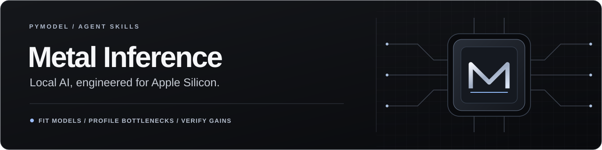

<p align="center">
  
</p>

<p align="center">
  <a href="SKILL.md"></a>
  <a href="references/apple-silicon.md"></a>
  <a href="scripts/"></a>
  <a href="LICENSE"></a>
</p>

<p align="center">
  <a href="#install">Install</a> &nbsp;·&nbsp;
  <a href="#capabilities">Capabilities</a> &nbsp;·&nbsp;
  <a href="#quickstart">Quickstart</a> &nbsp;·&nbsp;
  <a href="#documentation">Documentation</a>
</p>

**Metal Inference is an open-source agent skill for fitting, profiling, and optimizing local AI models on Apple Silicon.** It combines an agent-guided tuning workflow, diagnostic tools, and reproducible experiments for MLX-LM, llama.cpp/GGUF, Metal kernels, and Core ML Neural Engine investigations.

Find out what fits in unified memory, identify what actually limits inference, and validate faster configurations against memory and quality constraints. Metal Inference is a skill and toolkit, not a standalone inference engine.

## Install

With Node.js and npm installed, run this from the project where you use your coding agent:

```sh
npx skills add PyModel/metal-inference --skill metal-inference
```

Select your agent when prompted, or add `--agent codex` or `--agent claude-code`. Use `--global` to install across projects. The CLI discovers the root [SKILL.md](SKILL.md) and its companion scripts and references.

Ask your agent:

> Use metal-inference to identify what limits prefill and decode for my local model on this Mac. Recommend a faster configuration and verify it against a reproducible baseline.

For best results, include the model path, inference engine, target context length, concurrency, and the metric you want to improve. You can also use the [standalone tuning prompt](PROMPT.md) with agents that read files directly.

## Capabilities

| Area | What it helps you do |
| --- | --- |
| **Model fit** | Budget weights, KV cache or recurrent state, transients, GPU allocation, and macOS memory headroom. |
| **Performance profiling** | Separate cold prefill, warm-prefix latency, decode throughput, and concurrency. |
| **Engine tuning** | Investigate MLX-LM and llama.cpp/GGUF configuration, quantization, caching, and speculative decoding. |
| **Apple hardware** | Evaluate Metal kernels, TensorOps, and Core ML/ANE placement against a GPU baseline. |
| **Experiment design** | Rank candidate changes by critical-path savings, run controlled trials, and check quality and memory. |

The workflow prioritizes measured end-to-end gains over isolated kernel speedups or theoretical peak throughput.

## Quickstart

Clone the repository to run the tools independently of a coding agent:

```sh
git clone https://github.com/PyModel/metal-inference.git
cd metal-inference
python3 scripts/rank.py examples/critical-path.json
```

The example ranks optimization candidates without loading a model. Its illustrative inputs predict a 10 ms prefill saving, a 4 ms decode-dispatch saving, and a 2 ms loss from an ANE handoff. These are **not measured benchmark results**; replace them with timings from your own workload.

Inspect your Mac and estimate a model's memory requirements:

```sh
scripts/envelope.sh
scripts/fit.py --gguf model.gguf --ctx 32768 --layers 48 --kv-heads 8 --head-dim 128
python3 scripts/ceiling.py examples/ceiling.json
```

Replace the placeholder GGUF path and architecture values with your model's actual metadata, and the ceiling example with measured inputs. The envelope reports host memory, GPU allocation, engines, and ports. Missing telemetry yields `UNKNOWN`; estimated GPU budgets yield `PROVISIONAL`. Neither is a fit approval.

### Optimization workflow

1. **Measure** — record the device, runtime, model revision, workload, and baseline.
2. **Diagnose** — identify the dominant constraint and estimate practical performance ceilings.
3. **Rank** — prioritize experiments using critical-path latency and risk.
4. **Benchmark** — isolate one change against interleaved controls; retain raw measurements.
5. **Qualify** — repeat gains beyond noise and preserve output quality, memory limits, and rollback capability.

See the [experiment procedure](references/experiments.md#control-ledger-and-decision-record) for the full qualification protocol.

### Requirements

- Apple Silicon Mac running macOS for hardware diagnostics and benchmarking.
- Python 3.9+ and a local OpenAI-compatible streaming server for the benchmark harness.
- MLX installed in the Python environment used for MLX calibration.
- Swift and macOS 14.4+ SDK/runtime for the Core ML plan inspector.
- Node.js and npm for skills.sh installation only.

## Documentation

| Guide | Scope |
| --- | --- |
| [Agent skill](SKILL.md) · [Standalone prompt](PROMPT.md) | Agent workflow and decision rules |
| [Apple Silicon](references/apple-silicon.md) · [Memory](references/memory.md) | Hardware envelope and memory budgets |
| [Model architectures](references/architectures.md) | KV/state estimates and model-specific constraints |
| [Measurement](references/measurement.md) · [Ceilings](references/ceilings.md) | Metrics, controls, and performance bounds |
| [Opportunity inventory](references/apple-opportunities.md) | Prefill, decode, scheduling, and memory tuning |
| [Experiment procedure](references/experiments.md) | Reproducible benchmarks and qualification |
| [Metal and ANE](references/metal-ane.md) | Kernels, TensorOps, and Core ML investigations |
| [Sources and versions](references/sources.md) | Version-sensitive capabilities and verified references |

## Development

Run the fit self-test and repository test suite:

```sh
scripts/fit.py --self-test
python3 -B -m unittest discover -s tests
```

For a bug report or optimization proposal, include the device, macOS and engine versions, model revision, workload, expected behavior, and relevant measurements. Use [GitHub Issues](https://github.com/PyModel/metal-inference/issues) for reports and proposals.

## License

[MIT](LICENSE) · © 2026 PyModel LLC.

The [design map](references/adoption-map.md) identifies adapted materials covered by the [upstream MIT notice](LICENSE-inference-optimisation).

<p align="center">
  <a href="https://github.com/PyModel">PyModel</a> &nbsp;·&nbsp;
  <a href="https://skills.sh/pymodel">Agent skills</a> &nbsp;·&nbsp;
  <a href="https://skills.sh/docs">Skills CLI</a>
</p>
